## Mtaias lopez NC 0117
## operacion basica con open cv
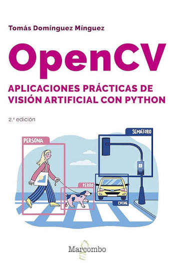
## cuando no puede cargar la imagen
# 1. LECTURA DE LA IMAGEN DESDE LA CARPETA
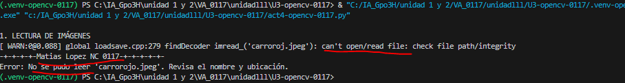
## cuando si puede cargar
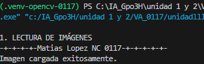
# 2. PROPIEDADES DE LA IMAGEN
## mostrar imagen original
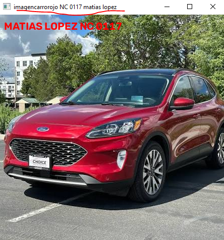

# 4. ACCESO Y MODIFICACIÓN DE PÍXELES INDIVIDUALES
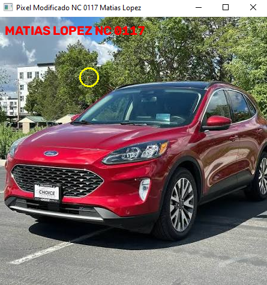
# 5. REGIÓN DE INTERÉS (ROI - REGION OF INTEREST)
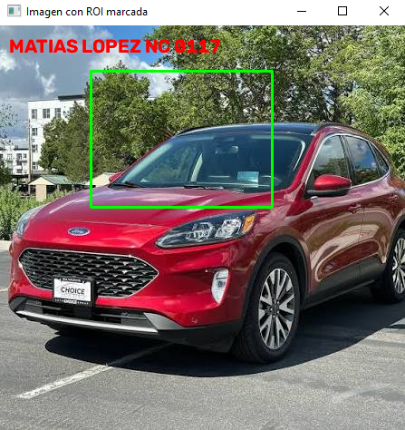
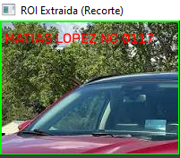
# 6. SEPARACIÓN Y FUSIÓN DE CANALES DE COLOR (BGR)
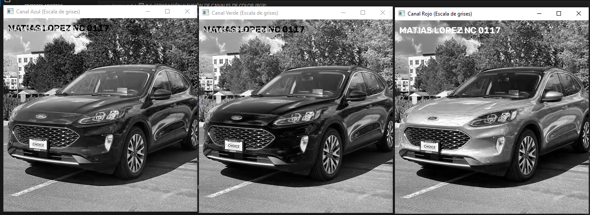
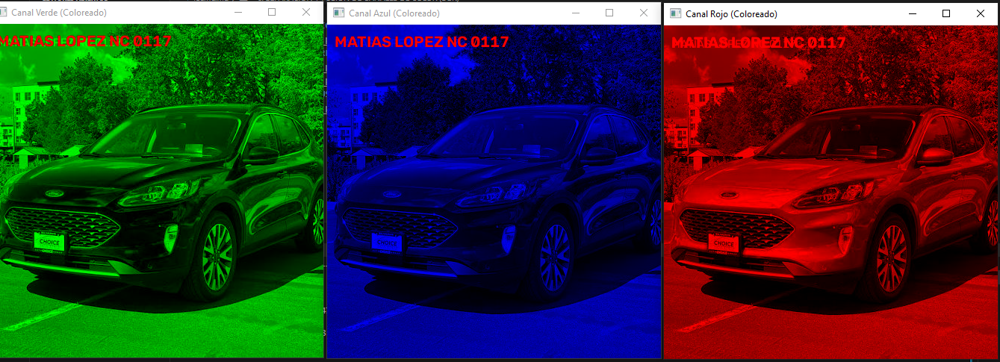
# 7. REDIMENSIONAMIENTO DE IMÁGENES (RESIZING)
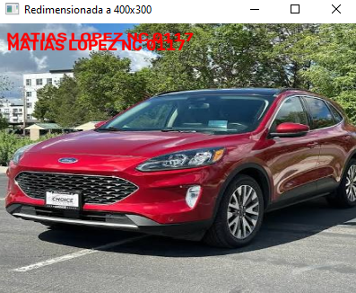
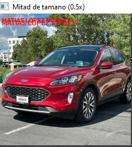
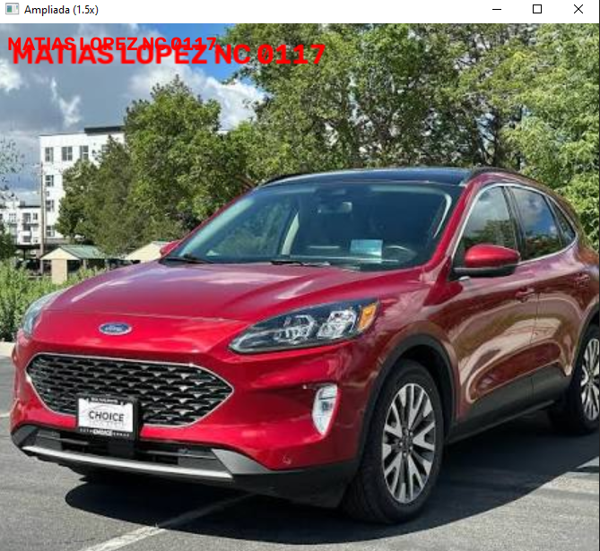
# 8. ROTACIÓN DE IMÁGENES
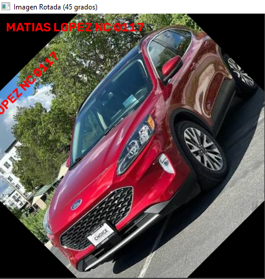
# 9. VOLTEO / ESPEJO DE IMÁGENES (FLIPPING)
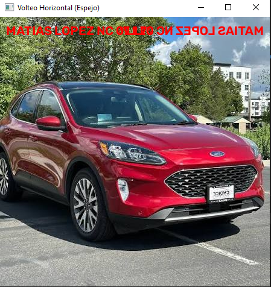
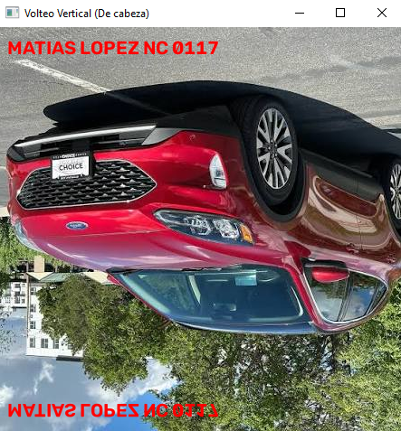
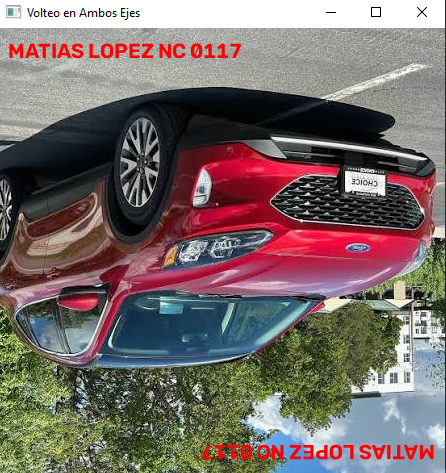
# 10. GUARDADO DE RESULTADOS Y LIMPIEZA
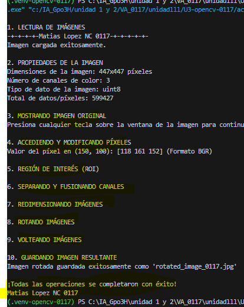